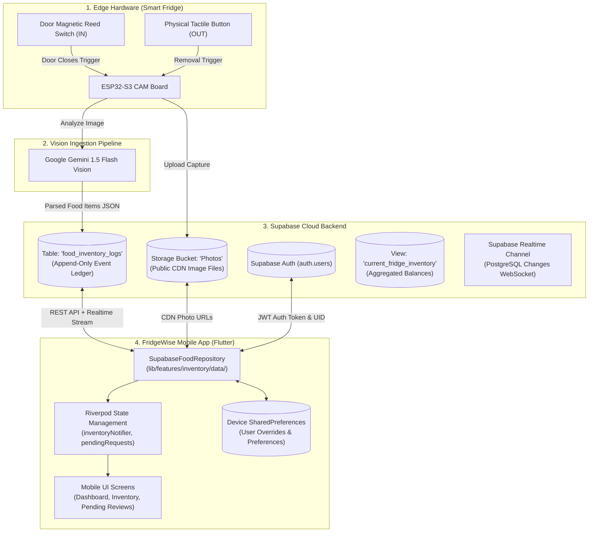
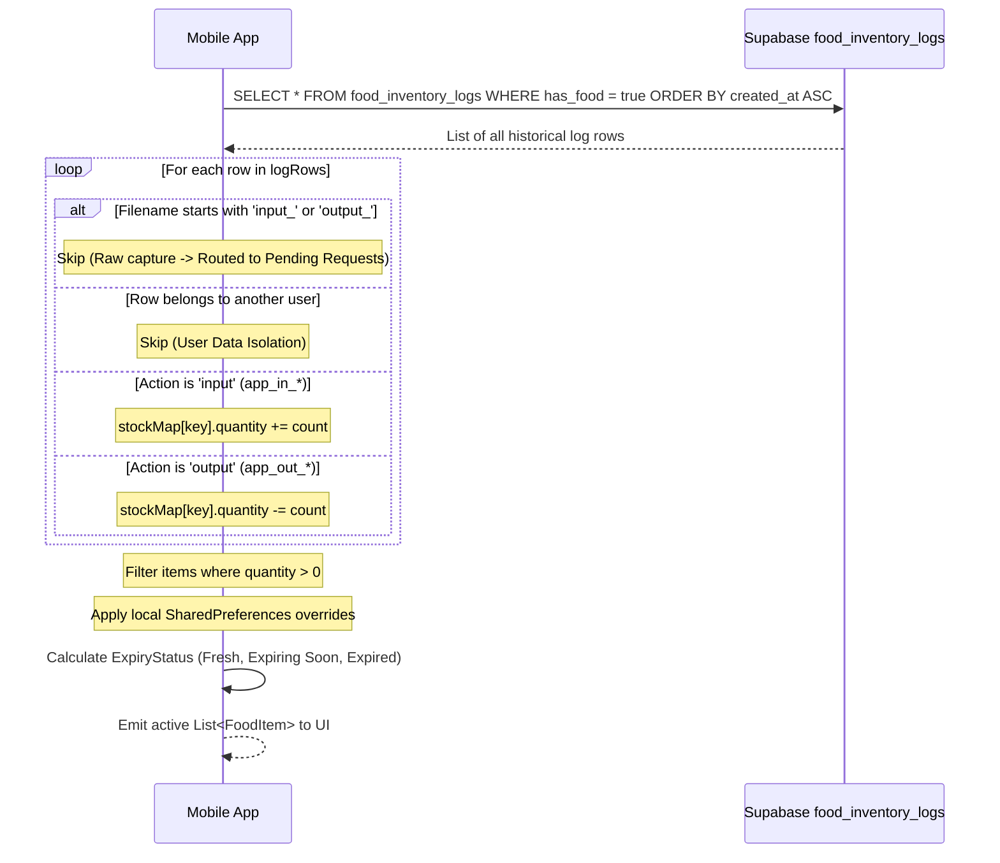

# FridgeWise — System Data Architecture & Data Flow Guide

Comprehensive technical documentation detailing where all data is stored, database schemas, hardware ingestion pipelines, real-time synchronization, and client-side inventory reconciliation in the **FridgeWise** Smart Fridge Management System.

---

## 1. System Architecture Overview

FridgeWise uses a distributed 3-tier IoT architecture combining edge hardware, cloud AI vision, an event-sourced Supabase backend, and a reactive cross-platform Flutter client:



---

## 2. Where the Data is Stored

The application stores data across three primary layers:

| Layer | Technology | Purpose |
| :--- | :--- | :--- |
| **Relational Database** | Supabase (PostgreSQL 15+) | Stores all inventory activity logs, food metadata, quantities, expiration dates, and audit events. |
| **Cloud Object Storage** | Supabase Storage (`Photos` Bucket) | Hosts public image files captured by the ESP32 camera and user profile pictures. |
| **On-Device Storage** | Android / iOS `SharedPreferences` | Stores user-specific local edits, dismissed notifications, theme mode, and push notification alert settings. |

---

## 3. Database Tables, Views & Storage Buckets

### A. Primary Table: `food_inventory_logs`
* **Location in Code**: Defined in `SupabaseConstants.tableInventoryLogs` ([supabase_service.dart](file:///Users/hello/food_management/lib/core/services/supabase_service.dart#L12)).
* **Design Pattern**: **Append-Only Event Ledger (Event Sourcing)**. Rows are never overwritten or deleted during normal operations. Every intake, edit, takeout, or discard is recorded as a new discrete log row.

#### Column Schema

| Column Name | SQL Data Type | Nullable | Description & Usage |
| :--- | :--- | :--- | :--- |
| `id` | `BIGINT` | `NO` | Primary key; auto-incrementing sequential log ID. |
| `filename` | `TEXT` | `NO` | Name of the picture stored in the `Photos` bucket. Identifies the action source:<br>• `input_*.jpg`: Raw ESP32 intake capture<br>• `output_*.jpg`: Raw ESP32 takeout capture<br>• `app_in_*.jpg`: User-confirmed intake / manual entry<br>• `app_out_*.jpg`: User-confirmed takeout / deduction<br>• `app_edit_*.jpg`: User-modified food metadata |
| `action_type` | `TEXT` | `NO` | Inventory delta direction: `'input'` (adding stock) or `'output'` (deducting stock). |
| `has_food` | `BOOLEAN` | `NO` | `true` if food was identified; `false` if non-food item or empty fridge view. |
| `item_count` | `INTEGER` | `NO` | Quantity involved in this specific event (default: `1`). |
| `detected_items`| `JSONB` | `YES` | Structured array of food item objects containing detailed metadata, timestamps, storage compartments, and ownership tags. |
| `notes` | `TEXT` | `YES` | Contextual description, Gemini AI reasoning, audit trail, and user UID tag (`[uid:...]`). |
| `created_at` | `TIMESTAMPTZ` | `NO` | Exact timestamp when the record was inserted. |

#### Structure of the `detected_items` JSONB Column

Each entry in `detected_items` contains the following fields:

```json
[
  {
    "name": "Bread",
    "user_id": "1cfe4919-fe51-461a-8058-48976ad1dd1d",
    "category": "Bakery",
    "storage_location": "refrigerator",
    "location": "Refrigerator",
    "expiry_date": "2026-11-22T00:00:00.000Z",
    "purchase_date": "2026-11-14T00:00:00.000Z",
    "unit": "pcs",
    "source_request_id": "87",
    "source_filename": "input_390452_ac7c.jpg",
    "photo_filename": "input_390452_ac7c.jpg",
    "image_url": "https://jwotitqnioaibeapqjgi.supabase.co/storage/v1/object/public/Photos/input_390452_ac7c.jpg"
  }
]
```

---

### B. Database View: `current_fridge_inventory`
A calculated PostgreSQL view providing an aggregated snapshot of active items across the entire fridge ledger:
* `item_name` (`TEXT`): Food item name.
* `category` (`TEXT`): Food category (e.g. Dairy, Fruit, Bakery).
* `in_stock_quantity` (`DOUBLE PRECISION`): Current net balance ($\sum \text{input} - \sum \text{output}$).
* `last_updated` (`TIMESTAMPTZ`): Timestamp of the most recent log.

---

### C. Cloud Storage Bucket: `Photos`
* **Bucket Identifier**: `'Photos'` (configured as a Public bucket).
* **Public CDN URL Structure**:
  ```text
  https://jwotitqnioaibeapqjgi.supabase.co/storage/v1/object/public/Photos/<filename>
  ```
* **Stored Assets**:
  1. **ESP32 Intake Captures**: `input_<timestamp>_<hex>.jpg`
  2. **ESP32 Takeout Captures**: `output_<timestamp>_<hex>.jpg`
  3. **User Profile Avatars**: `avatar_<uid>_<timestamp>.jpg`

---

### D. Local On-Device Storage (`SharedPreferences`)
Stored on the mobile device (`/data/data/.../shared_prefs/`):
* `saved_food_item_edits_<uid>`: JSON map of user adjustments (custom food names, modified expiry dates, custom notes) scoped to the active user's UID.
* `dismissed_pending_requests`: String list of dismissed hardware request IDs so they do not reappear on subsequent boots.
* `user_pref_daily_digest`: Boolean flag for daily expiry summary notifications.
* `user_pref_alert_days_before`: Integer threshold (e.g., 1, 2, or 3 days) before expiration to trigger urgent alert cards.
* `theme_mode`: Selected theme preference (`system`, `light`, or `dark`).

---

## 4. How Data Enters the System (Ingestion Pipelines)

### Flow 1: Hardware IN Capture (ESP32 Door Switch)
1. User opens the fridge door, inserts groceries, and closes the door.
2. The magnetic reed switch detects door closure and triggers the **ESP32-S3 CAM**.
3. The ESP32 captures a JPEG photo and uploads it to the Supabase `Photos` bucket as `input_<timestamp>_<hash>.jpg`.
4. The image bytes are sent to **Google Gemini 1.5 Flash Vision** with a prompt instructing it to identify food items, categories, and estimated shelf life.
5. The ESP32 inserts a pending log entry into `food_inventory_logs`:
   * `filename`: `'input_390452_ac7c.jpg'`
   * `action_type`: `'input'`
   * `has_food`: `true`
   * `detected_items`: `[{"name": "Bread", "category": "Bakery"}]`
6. Because the filename starts with `input_`, the mobile app classifies it as an **unconfirmed pending intake request**.

---

### Flow 2: Hardware OUT Capture (ESP32 OUT Button)
1. User presses the physical tactile OUT button on the fridge exterior before or after removing food.
2. The ESP32 takes a picture of the removal event and uploads it to the `Photos` bucket as `output_<timestamp>_<hash>.jpg`.
3. The ESP32 inserts an unconfirmed takeout row into `food_inventory_logs`:
   * `filename`: `'output_458213_e8fc.jpg'`
   * `action_type`: `'output'`
   * `has_food`: `true`
4. The mobile app shows a **Pending Food Removal** notification prompting the user to review the photo and confirm which item was taken out.

---

### Flow 3: User Verification & Confirmation Workflow
1. The user taps the notification or opens **Review Intake** / **Review Removal** in the app.
2. The user inspects the captured camera photo (with pinch-to-zoom support).
3. The user edits or confirms the food name, compartment (Refrigerator, Freezer, Deep Fridge), and expiration date.
4. When tapping **Confirm Intake**, the app inserts a confirmed log into `food_inventory_logs`:
   * `filename`: `'app_in_<timestamp>_<name>.jpg'`
   * `action_type`: `'input'`
   * `notes`: `'Confirmed intake for request #87 (input_390452_ac7c.jpg) [uid:<uid>]'`
   * `detected_items`: Contains full details plus `source_request_id: '87'`.
5. This clears request `#87` from the pending list and **officially enters the item into active inventory**.

---

### Flow 4: Manual Item Registration
1. User taps **+ Add Item** in the mobile app.
2. User enters item details (or scans a barcode) and taps **Save Food Item**.
3. The app directly inserts an `app_in_...` row with `action_type: 'input'` and the user's `uid`.

---

## 5. How the App Calculates Active Inventory (Reconciliation Engine)

In [supabase_food_repository.dart](file:///Users/hello/food_management/lib/features/inventory/data/supabase_food_repository.dart#L240-L380), the `getItems()` method performs client-side event sourcing reconciliation:



### Expiry Calculation Logic
The app dynamically categorizes each food item using [expiry_calculator.dart](file:///Users/hello/food_management/lib/features/inventory/domain/models/expiry_status.dart):
$$\text{Days Remaining} = \text{ExpiryDate} - \text{CurrentDate}$$

* $\text{Days Remaining} > 3 \text{ days}$: **Fresh** (Green badge)
* $0 \le \text{Days Remaining} \le 3 \text{ days}$: **Expiring Soon** (Orange badge)
* $\text{Days Remaining} < 0 \text{ days}$: **Expired** (Red alert badge)

---

## 6. Real-Time Synchronization Mechanism

The app updates automatically without requiring manual pull-to-refresh:

1. **Supabase Realtime WebSocket**:
   Upon startup, `SupabaseFoodRepository` establishes a WebSocket subscription:
   ```dart
   client.channel('fridge_realtime_channel')
         .onPostgresChanges(
           event: PostgresChangeEvent.all,
           schema: 'public',
           table: 'food_inventory_logs',
           callback: (payload) => _refreshAll(),
         )
         .subscribe();
   ```
2. **4-Second Polling Fallback**:
   A periodic background timer executes every 4 seconds to guarantee updates if the device experiences network jitter or drops WebSocket connection.
3. **Reactive Riverpod Flow**:
   When `_refreshAll()` runs:
   * `foodRepositoryProvider` fetches updated items and pending requests.
   * `inventoryNotifierProvider` updates its `List<FoodItem>`.
   * `inventorySummaryProvider` recalculates dashboard metric cards.
   * `recipesListProvider` re-evaluates zero-waste cooking suggestions using remaining fridge ingredients.

---

## 7. Multi-User Isolation & Security

1. **User Identity**:
   Users authenticate using Supabase Auth (`email` and `password`). User identity is stored in `auth.users`, and identity attributes are managed via `authProvider` ([auth_provider.dart](file:///Users/hello/food_management/lib/features/auth/data/auth_provider.dart)).
2. **Record Tagging**:
   Every database write (`addItem`, `updateItem`, `markConsumed`, `confirmIntake`, `confirmTakeOut`) embeds the authenticated user's ID inside the `detected_items` JSONB payload and appends `[uid:<uid>]` to the `notes` column.
3. **Data Scoping**:
   * When a user logs in, `foodRepositoryProvider` is instantiated with `userId: auth.uid`.
   * Queries filter out any records belonging to other users.
   * New user accounts begin with a **clean, empty inventory (0 items)**.
   * Existing prototype items remain linked to the primary account (`farihayasmeen0612@gmail.com`).
4. **Local Storage Separation**:
   `SharedPreferences` keys are postfixed with the user's UID (`saved_food_item_edits_<uid>`), ensuring two users sharing the same phone never see each other's custom edits or cached data.

