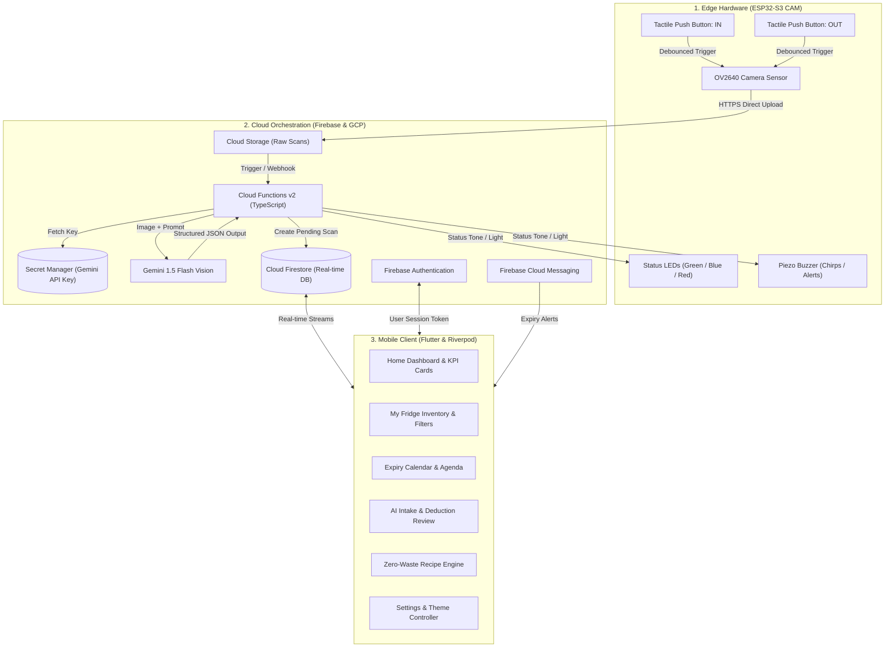
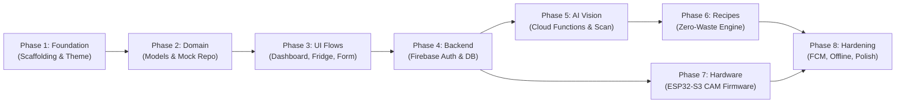

# Smart Fridge Food & Expiry Management System
## End-to-End Implementation Phases & Engineering Roadmap

**Document Version:** 1.0.0  
**Project Workspace:** `/Users/hello/food_management`  
**Stack:** Flutter 3.47.2, Dart 3.13.2, Riverpod 3.4.3, GoRouter 18.1.1, Firebase, Google Gemini 1.5 Flash Vision, ESP32-S3 CAM  
**Design Standard:** Material 3 Dual-Theme (Light & Dark), Zero Emojis, Vector Iconography  

---

## 1. System Architecture Overview

The system is organized into three interconnected tiers:
1. **Mobile Application (Flutter & Dart):** Cross-platform client providing real-time inventory tracking, multi-tier expiry alerts, zero-waste recipe suggestions, and AI review confirmation.
2. **Cloud Orchestration & AI Inference (Firebase & GCP):** Serverless Cloud Functions v2 invoking Google Gemini 1.5 Flash Vision with zero API keys exposed to edge or client.
3. **Edge Hardware (ESP32-S3 CAM):** Dedicated external camera module with tactile push buttons ("IN" and "OUT"), visual status LEDs, and acoustic piezo cues.



---

## 2. Phase-by-Phase Implementation Roadmap



---

### Phase 1: Project Scaffolding & Foundation
* **Status:** `COMPLETED` (Git commit: `086ca7b`)
* **Objective:** Initialize a clean, robust Flutter project with foundational state management, declarative routing, and a Material 3 dual-theme engine.
* **Key Deliverables:**
  * Initialized Flutter project with package name `food_management` and git version tracking.
  * Added core dependencies: `flutter_riverpod`, `go_router`, `shared_preferences`, `intl`.
  * Implemented `AppColorsExtension` (`ThemeExtension`) for semantic color tokens (`surfaceElevated`, `cardBorder`, `freshnessSuccess`, `warningAmber`, `dangerRed`, `textSecondary`).
  * Implemented centralized `AppTheme` with `lightTheme` and `darkTheme` (`useMaterial3: true`).
  * Implemented `ThemeNotifier` using modern Riverpod `Notifier<ThemeMode>` with persistence via `SharedPreferences`.
  * Configured persistent bottom navigation shell (`StatefulShellRoute.indexedStack`) linking 5 primary tabs: Dashboard, Fridge, Calendar, Recipes, and Settings.
  * Built interactive theme selector on Settings screen (`SegmentedButton`).
* **Verification & Checks:**
  * `flutter analyze`: 0 issues found.
  * `flutter test`: App bootstrap, widget pump, and tab navigation verified.

---

### Phase 2: Core Data Models & Local Mock Repository
* **Status:** `COMPLETED` (Git commit: `c185797`)
* **Objective:** Establish the domain business logic, shelf-life calculations, immutable data models, and an offline mock data source for zero-dependency UI development.
* **Key Deliverables:**
  * Defined domain enums:
    * `FoodCategory`: 10 categories with assigned rounded vector icons and zero emojis.
    * `StorageLocation`: `fridge`, `freezer`, `pantry`.
    * `ExpiryStatus`: `fresh` (>3 days), `expiringSoon` (0–3 days), `expired` (<0 days).
    * `ItemStatus`: `active`, `consumed`, `discarded`.
  * Created `ExpiryCalculator` utility:
    * Midnight normalization to eliminate clock/timezone drift.
    * Precise day difference calculation (`calculateDaysRemaining`).
    * Formatted human-readable countdowns ("Expired 2 days ago", "Expires today", "Expires tomorrow", "X days left").
  * Created immutable `FoodItem` model with `copyWith`, `toMap`/`fromMap`, and dynamic expiry getters.
  * Created `ActivityLogItem` model for item additions, partial/full consumption, and discards.
  * Created `InventorySummary` model computing aggregated KPI metrics.
  * Created `FoodRepository` interface and `MockFoodRepository` seeded with 10 realistic items.
  * Created Riverpod providers (`foodRepositoryProvider`, `inventoryNotifierProvider`, `inventorySummaryProvider`, `urgentItemsProvider`).
  * Updated Dashboard screen to display live KPI summary chips (**Tracked: 10**, **Expiring Soon: 4**, **Expired: 1**).
* **Verification & Checks:**
  * `flutter analyze`: 0 issues found.
  * `flutter test`: 17/17 tests passed (covering expiry mathematics, edge dates, countdown labels, serialization, repository filtering, consumption deductions, waste logs, and widget KPI rendering).

---

### Phase 3: Core UI Screens & User Flows (Offline / Mock Data)
* **Status:** `NEXT IN QUEUE` (Pending User Approval)
* **Objective:** Construct the complete, high-density user interface matching the UI reference designs, powered by the mock repository.
* **Key Deliverables:**
  1. **Dashboard Screen:**
     * Sticky top urgency alert banner (displays when expired items exist).
     * 3-column metric KPI summary bar: Tracked, Expiring Soon, Expired.
     * "Expiring Soon" priority carousel / horizontal scroll list with countdown pills.
     * "Quick Action" buttons for manual intake and scan trigger.
     * Contextual "Smart Tip" card.
  2. **Inventory Screen ("My Fridge"):**
     * Storage zone filter tabs: `Fridge`, `Freezer`, `Pantry`.
     * Category filter chips (`All`, `Produce`, `Dairy`, `Meat`, etc.).
     * Search bar with live debounced name filtering.
     * Sorting dropdown (by expiry date ascending/descending, alphabetical).
     * High-density food item cards with left category icon, item details, quantity tag, and right urgency badge.
     * Swipe-to-action or popup menu for Consume / Discard / Edit / Delete.
  3. **Expiry Calendar & Split Agenda Screen:**
     * Monthly interactive calendar view with color-coded marker dots (green = safe, amber = warning, red = expired).
     * Split-view day agenda listing items expiring on the selected day and upcoming items.
  4. **Manual Food Intake Screen (Add / Edit Form):**
     * Input fields: Item Name, Category picker chips, Storage Zone selector.
     * Dual date pickers: Purchase Date and Expiration Date with calendar selection.
     * Quantity stepper and unit selector (`pcs`, `kg`, `g`, `L`, `ml`, `packs`).
     * Remarks / Notes field.
     * Full-width primary CTA button ("Save Item").
  5. **Food Detail & Adjustment Sheet:**
     * Quantity adjustment stepper (for logging partial consumption).
     * One-tap actions: "Mark Consumed" and "Mark Discarded".
* **Testing & Acceptance Criteria:**
  * Adding an item via the form immediately increments Dashboard KPIs and appears in Inventory and Calendar.
  * Partial deduction updates item quantity and status appropriately.
  * Search and category filters operate seamlessly with zero lag.
  * Complete support for Light and Dark modes with zero pixel overflows.

---

### Phase 4: Firebase Integration (Auth & Realtime Firestore)
* **Status:** `PLANNED`
* **Objective:** Integrate Firebase Authentication and Cloud Firestore, replacing the mock repository with authenticated real-time cloud data.
* **Key Deliverables:**
  * Configure `firebase_core`, `firebase_auth`, and `cloud_firestore`.
  * Build Authentication flow:
    * Email and password sign-in and sign-up screens.
    * "Forgot Password?" reset dialog.
    * Auth state routing gate (`GoRouter` redirect based on `authStateChanges()`).
  * Implement `FirestoreFoodRepository`:
    * Firestore collections:
      * `users/{userId}/inventory/{itemId}`
      * `users/{userId}/activity_logs/{logId}`
      * `users/{userId}/preferences/settings`
    * Real-time snapshot streams binding into Riverpod notifiers.
  * Firestore Security Rules enforcing strict user isolation (users can only access their own subcollections).
  * Enable offline Firestore caching for seamless offline viewing.
* **Testing & Acceptance Criteria:**
  * User can register, log out, and log in.
  * Adding or editing an item on one client updates Firestore and reflects instantly across all open sessions.
  * Unauthenticated read/write requests are rejected by security rules.

---

### Phase 5: Cloud Functions & AI Vision Ingestion Pipeline
* **Status:** `PLANNED`
* **Objective:** Implement the serverless image recognition pipeline where food images uploaded to Cloud Storage are processed by Gemini 1.5 Flash Vision, returning structured food metadata.
* **Key Deliverables:**
  * Initialize Firebase Cloud Functions v2 in TypeScript.
  * Store the Gemini API key in **Google Cloud Secret Manager** (zero keys embedded in client or edge firmware).
  * Cloud Storage upload trigger (`onObjectFinalized`):
    * Reads uploaded JPEG from `scans/{userId}/{scanId}.jpg`.
    * Dispatches image buffer to Gemini 1.5 Flash Vision.
    * Enforces strict JSON Schema response:
      ```json
      {
        "foodName": "string",
        "category": "produce | dairy | meatPoultry | seafood | bakery | beverages | leftovers | condiments | frozen | other",
        "storageLocation": "fridge | freezer | pantry",
        "estimatedShelfLifeDays": 7,
        "quantity": 1.0,
        "unit": "pcs",
        "confidence": 0.95
      }
      ```
    * Writes candidate scan to `users/{userId}/pending_scans/{scanId}`.
  * Build "Scan Review" screen in Flutter:
    * Displays raw captured photo alongside Gemini's predicted attributes.
    * User can accept with one tap or edit fields before saving to active inventory.
* **Testing & Acceptance Criteria:**
  * Uploading a food picture creates a pending scan with parsed name, category, and shelf-life in < 3 seconds.
  * Flutter client displays the pending scan, allows user edits, and commits item to active inventory.

---

### Phase 6: Zero-Waste Recipe Recommendation Engine
* **Status:** `PLANNED`
* **Objective:** Automatically recommend recipes prioritizing food items currently nearing expiration in the user's fridge.
* **Key Deliverables:**
  * Cloud Function or secure client callable generating recipes via Gemini 1.5 Flash:
    * Passes active items sorted by urgency (expiring soon and expired).
    * Returns recipes structured as: Title, prep time, difficulty, required expiring ingredients, pantry staples, and sequential cooking steps.
  * Build Recipes UI in Flutter:
    * Recipe feed featuring a **"USING YOUR EXPIRING ITEMS"** badge.
    * Recipe Detail screen:
      * Meta badges: Prep time, Difficulty, Servings.
      * Ingredient checklist with visual indicators (in fridge vs pantry staple).
      * Numbered step cards for step-by-step cooking instructions.
      * "Cook This Recipe" action to automatically deduct or mark used ingredients as consumed.
* **Testing & Acceptance Criteria:**
  * Recipe suggestions directly cite ingredients currently flagged as expiring in the fridge.
  * Completing a recipe prompts the user to deduct the used ingredient quantities.

---

### Phase 7: ESP32-S3 CAM Edge Hardware Integration
* **Status:** `PLANNED`
* **Objective:** Program the ESP32-S3 CAM module to capture food images on physical button press ("IN" or "OUT") and securely transmit them to Cloud Storage.
* **Key Deliverables:**
  * ESP32-S3 CAM Firmware (C++ / Arduino or ESP-IDF):
    * Hardware debouncing: ignores rapid clicks within 3.0 seconds.
    * Generates a unique UUID `idempotency_key` per scan to reject duplicate uploads.
    * Sensor initialization (OV2640 / OV5640, UXGA / SVGA JPEG).
    * Tactile button GPIO mapping:
      * `GPIO 13`: "IN" Button (Adding food).
      * `GPIO 14`: "OUT" Button (Extracting food).
    * Acoustic buzzer cues via PWM:
      * Capture initiated: Single 50ms beep (2.4 kHz).
      * Upload success: Double rising chirp (2.0 kHz -> 2.8 kHz).
      * Error / Timeout: Triple low-pitch buzz (400 Hz).
    * Status LEDs:
      * Green: Standby / Ready.
      * Blue: Uploading & AI inference.
      * Red: Network or capture error.
  * Secure Upload Pipeline:
    * Direct HTTPS POST to Firebase Cloud Storage using pre-shared HMAC device token (`X-Device-Token`).
* **Testing & Acceptance Criteria:**
  * Pressing the "IN" button captures a frame, chirps, and delivers the JPEG to Cloud Storage within 4 seconds.
  * Flutter app receives the scan in the pending review list.

---

### Phase 8: System Hardening, Error Handling & End-to-End Acceptance
* **Status:** `PLANNED`
* **Objective:** Conduct end-to-end integration testing, background notifications, offline resilience, and production polish.
* **Key Deliverables:**
  * Firebase Cloud Messaging (FCM):
    * Scheduled Cloud Function daily cron checking expiring items.
    * Dispatches background push notifications at user's preferred digest hour.
  * Offline resilience: Local SQLite / Firestore offline cache synchronization.
  * Performance tuning: Image downsampling prior to display, list view recycling.
  * Comprehensive End-to-End Walkthrough:
    1. Physical ESP32 "IN" button pressed with food in front of camera.
    2. Image uploaded to Cloud Storage; Cloud Function invokes Gemini 1.5 Flash.
    3. Push notification received on mobile; Scan Review screen opened.
    4. Food item confirmed and added to active fridge inventory.
    5. Item countdown tracked on Dashboard and Expiry Calendar.
    6. Recipe suggested using the item as it nears expiration.
    7. Physical ESP32 "OUT" button pressed or manual deduction logged; item marked consumed.
* **Testing & Acceptance Criteria:**
  * Full lifecycle runs with 0 unhandled exceptions.
  * All unit, widget, and integration tests pass cleanly.

---

## 3. Strict Development Rules & Standards

1. **Zero-Emoji Rule:** Emojis are strictly prohibited in application code, assets, mock data, and documentation. All visual indicators must use Material Symbols / vector icons.
2. **Dual-Theming Strictness:** Never hardcode color values in widget trees. All colors must be resolved dynamically via `Theme.of(context).colorScheme` or `context.appColors`.
3. **Beginner-Friendly Architecture:** Avoid over-abstraction (no convoluted boilerplate use-case layers for single-line queries). Maintain clean `features/<feature_name>/` structure: `domain`, `data`, `presentation`.
4. **Security Priority:** Never expose Google Gemini API keys or Firebase Admin credentials in mobile application code or ESP32 firmware. All AI calls must route through serverless Cloud Functions protected by Secret Manager.
5. **Phase Gate Approval:** Never proceed to the next development phase without explicit project owner approval.

---

## 4. Quick Verification Commands

```bash
# 1. Run static analysis
flutter analyze

# 2. Run all unit and widget tests
flutter test

# 3. Launch application in Chrome Web
flutter run -d chrome

# 4. Launch application on macOS Desktop
flutter run -d macos
```
