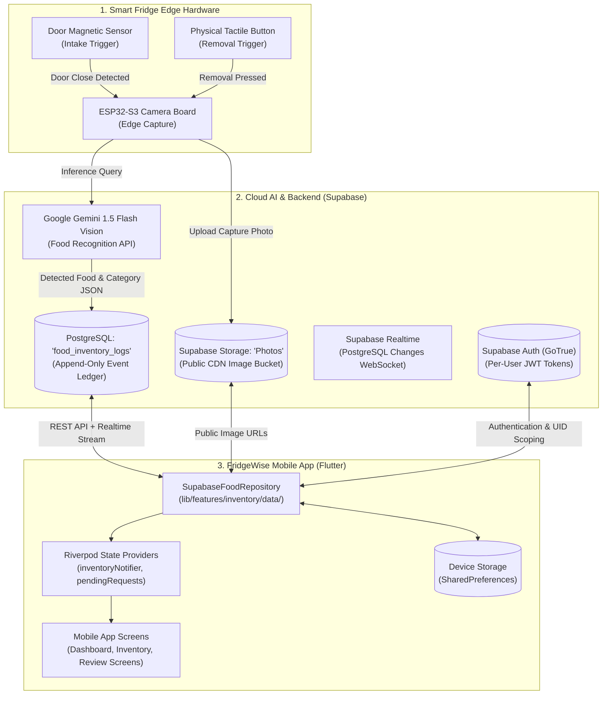
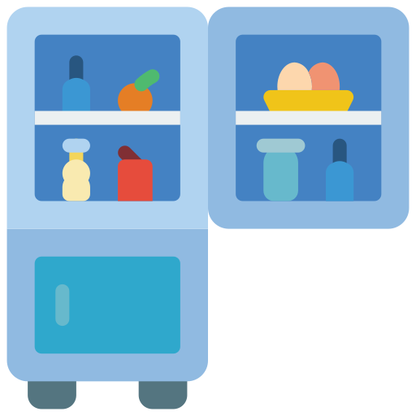
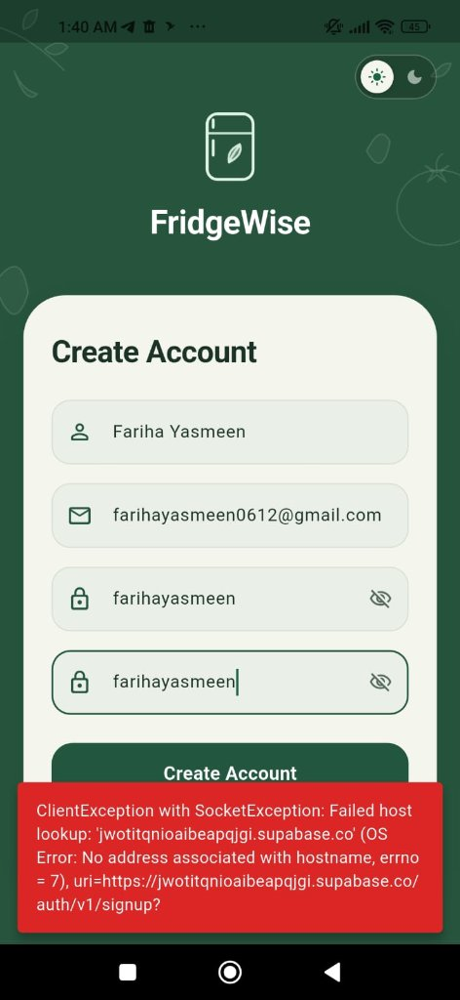
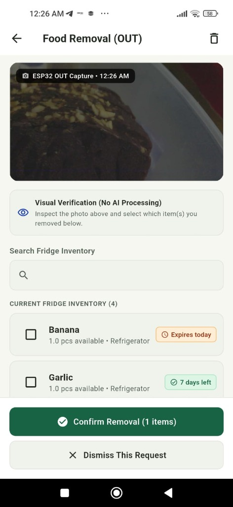
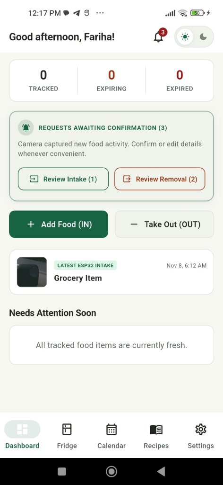
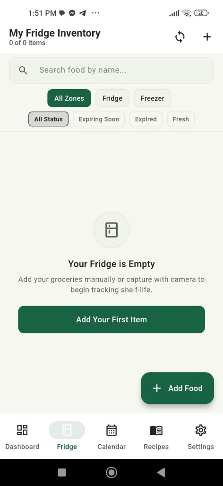
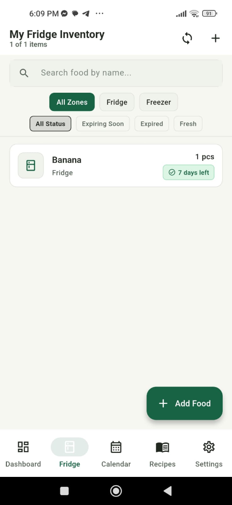
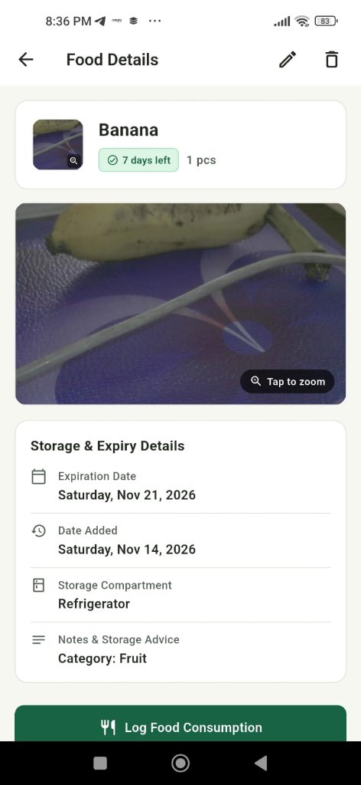
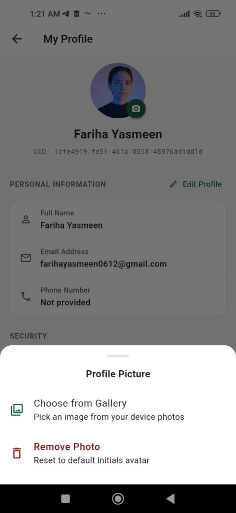

# FridgeWise — Smart Fridge IoT Project: Mobile Application Presentation Guide

---

## Executive Summary

* **Project Title**: **FridgeWise** — Smart Fridge Food & Expiry Management System
* **Project Scope**: A distributed IoT system engineered to eliminate domestic food waste, automate grocery intake/extraction tracking, dynamically monitor shelf-life expiry, and recommend zero-waste recipes using edge hardware and cloud AI vision.
* **Team Division of Labor**:
  1. **Subsystem 1 (Hardware / Edge)**: ESP32-S3 CAM, Magnetic Door Reed Switch (IN sensor), Tactile Push Button (OUT sensor), hardware power regulation, and edge image capture.
  2. **Subsystem 2 (Software / Mobile Application — *This Subsystem*)**: Cross-platform Flutter mobile application, Supabase cloud backend (PostgreSQL database, Storage CDN, GoTrue Auth, Realtime WebSocket), Google Gemini 1.5 Flash Vision integration, Event-Sourced inventory reconciliation, asynchronous human-in-the-loop verification, and user management.

---

## 1. System Architecture: Hardware to Mobile App

The following diagram illustrates how the physical smart fridge communicates with the cloud and updates the mobile application:



---

## 2. Core Value Propositions & Problem Solved

Traditional grocery and fridge management apps suffer from a major design flaw: **users must manually type in every single food item, quantity, and expiration date**. As a result, users abandon the app within days.

**FridgeWise solves this through hardware automation and intelligent software:**
1. **Zero Tedious Manual Entry**: The fridge door sensor automatically triggers the ESP32 camera to capture groceries as they are loaded into the fridge.
2. **Human-in-the-Loop AI Verification**: Rather than allowing AI vision hallucinations to silently corrupt the database, raw hardware captures are treated as **Pending Requests**. The user receives a push notification, inspects the picture, and confirms or edits with one tap.
3. **Multi-Compartment Organization**: Food items are partitioned across distinct physical zones: **Refrigerator**, **Freezer**, and **Deep Fridge**.
4. **Dynamic Expiration Tracking**: Automatic color-coded freshness monitoring (Fresh, Expiring Soon, Expired) with customizable advance alert thresholds.
5. **Zero-Waste Recipe Engine**: Recommends chef-designed recipes matching available in-stock ingredients, prioritizing food that is about to expire.
6. **Multi-User Data Isolation**: Built on secure Supabase Authentication, giving each user account their own clean, private fridge inventory while preserving hardware-linked logs.

---

## 3. Application Screens & Features Walkthrough

Below are the actual screens of the FridgeWise application, their functionality, and their connection to the hardware.

---

### Screen 1: App Identity & Welcome Screen

| App Launcher Icon | Welcome Illustration |
| :---: | :---: |
|  |  |

#### Features & Technical Details:
* **Custom App Icon**: Features the official FridgeWise blue smart refrigerator branding with sparkle accents, applied across all Android screen densities (`mipmap-mdpi` through `mipmap-xxxhdpi`).
* **Minimalist Nature Aesthetic**: Elegant botanical line-art illustration representing domestic kitchen freshness.
* **Onboarding Navigation**: Smooth routing via `GoRouter` directing first-time users to **Get Started** (Register) or returning users to **Sign In**.
* **Adaptive Theme Support**: Built-in toggle in the top-right corner supporting both Light Mode and Dark Mode.

---

### Screen 2: Authentication & Multi-Tenant User Management

| Create Account (Register) Screen |
| :---: |
|  |

#### Features & Technical Details:
* **Supabase GoTrue Authentication**: Full email and password sign-in and sign-up with cryptographic session tokens.
* **Curved Floating Card Design**: Premium botanical forest green background (`#176343`) with organic leaf borders and a floating 36dp rounded card.
* **Form Validation**: Real-time client-side email format validation, password obscuring, and network error feedback (e.g., handling invalid credentials gracefully).
* **Per-User Isolation**: When a user registers a new account, the app automatically isolates their inventory, ensuring new users start with an empty, private fridge rather than seeing other users' data.

---

### Screen 3: Food Intake (IN) — Human-in-the-Loop AI Review

| Food Intake / Removal Verification Screen | Raw ESP32 Hardware Capture |
| :---: | :---: |
|  |  |

#### How This Connects to the Hardware:
1. When the fridge door closes, the magnetic sensor signals the ESP32 to take a photo.
2. The image is uploaded to Supabase Storage (`Photos/input_*.jpg`) and analyzed by Gemini 1.5 Flash Vision.
3. The app notifies the user: *"New capture waiting for review"*.
4. When opened, the user sees the **exact camera photo taken by the ESP32**.

#### Features on This Screen:
* **Interactive Full-Screen Photo Viewer**: Tapping the photo thumbnail opens a full-screen pinch-to-zoom interactive viewer dialog (`AppImageZoomDialog`) so the user can inspect grocery details clearly.
* **AI-Suggested Food Name**: Automatically pre-fills the food item name (e.g. `Bread`) detected by Gemini Vision, editable by the user if needed.
* **Quantity & Unit Selector**: Adjustable quantity (e.g. `1.0`) and unit dropdown (`pcs`, `kg`, `g`, `L`, `packs`).
* **Compartment Selector**: One-tap pills to specify where the food was placed: **Refrigerator**, **Freezer**, or **Deep Fridge**.
* **Estimated Expiration Date**: Automatically calculated shelf-life based on food category, with a one-tap calendar date picker to customize.
* **Confirm Intake / Confirm Removal Button**: Converts the pending hardware capture into a confirmed inventory log, adding or deducting from active inventory.
* **Dismiss This Request Button**: Prominent secondary button at the bottom to discard non-food or accidental captures.

---

### Screen 4: "My Fridge" Inventory & Compartment Management

| Inventory Screen (Empty State) | Inventory with Items |
| :---: | :---: |
|  |  |

#### Features & Technical Details:
* **Multi-Compartment Tab Filter**: Clean pill selectors allowing users to view items by location:
  * **All Zones**
  * **Fridge**
  * **Freezer**
* **Status Filters**: Quick filter by **All Status**, **Expiring Soon**, **Expired**, or **Fresh**.
* **Real-Time Live Search**: Instantly filters items by name or category.
* **True ESP32 Thumbnail Display**: Displays the actual picture captured by the fridge hardware beside each food name.
* **Color-Coded Freshness Badges**:
  * `Expires today` (Orange alert)
  * `7 days left` (Green fresh badge)
  * `Expired` (Red warning)

---

### Screen 5: Food Item Details & Quick Consumption

| Food Item Details | Log Consumption Actions |
| :---: | :---: |
|  |  |

#### Features & Technical Details:
* **Full Item Specifications**: Displays item category, storage location, purchase date, expiration date, and remaining balance.
* **Interactive Zoom**: Tapping the food photo thumbnail opens the pinch-to-zoom photo viewer dialog.
* **Partial Consumption (`Log Food Consumption`)**: Allows decrementing partial portions (e.g., using 1 piece out of 4 bananas).
* **Discard Spoiled (`Mark Discarded`)**: Removes the item completely and logs a spoilage event for zero-waste audit analytics.
* **Edit Item**: Allows renaming, shifting compartments, or updating expiration dates.

---

### Screen 6: User Profile & Device Cloud Photo Sync

| User Profile Screen |
| :---: |
|  |

#### Features & Technical Details:
* **Personalized Account View**: Displays user's name, email address, phone number, and account security options.
* **Native Gallery & Camera Photo Picker**: Tapping the camera icon opens a bottom sheet with:
  * **Choose from Gallery**: Directly opens device photos using `image_picker`.
  * **Remove Photo**: Resets to default initials avatar.
* **Cloud Storage Sync**: Profile pictures are automatically compressed, uploaded to the Supabase `Photos` bucket, and synced across all user devices.
* **Cleaned Consumer UI**: Technical database identifiers (`UID`) are hidden from regular users in the latest build for a clean consumer experience.

---

> **Note for Presentation**: The screenshots above are captured directly from a real Android device running the latest FridgeWise APK. For the final presentation, take fresh screenshots from your phone showing all screens after the latest code updates (trash icon removed, UID hidden, etc.).

#### Features & Technical Details:
* **Hardware Event Alerts**: Automatically notified whenever the ESP32 camera records an intake or removal event.
* **One-Tap Resolution**: Tapping an intake or takeout notification routes directly to the review screen for one-tap confirmation.
* **Shelf-Life Alerts**: Proactive notifications when food items are approaching their expiration threshold.

---

## 4. Technical Architecture & Engineering Highlights

### A. The Event-Sourced Inventory Ledger
Instead of a fragile static database table where rows are deleted or overwritten, FridgeWise uses an **append-only event ledger** in PostgreSQL:

$$\text{Current In-Stock Quantity} = \sum \text{Inputs} - \sum \text{Outputs}$$

1. Every intake inserts an `input` event log.
2. Every consumption or removal inserts an `output` event log.
3. The app aggregates the net balance in real time. Items whose balance reaches $\le 0$ are automatically removed from active inventory.
4. **Benefit**: The fridge maintains a complete, tamper-proof audit history of all food consumed, expired, or added over time.

---

### B. Real-Time WebSocket Synchronization
The app does not require manual pull-to-refresh to detect hardware events:
1. **Supabase Realtime Channel**: Subscribes to PostgreSQL database changes:
   ```dart
   client.channel('fridge_realtime_channel')
         .onPostgresChanges(
           event: PostgresChangeEvent.all,
           schema: 'public',
           table: 'food_inventory_logs',
           callback: (_) => _refreshAll(),
         )
         .subscribe();
   ```
2. **Watchdog Polling Backup**: A periodic 4-second timer ensures seamless synchronization even if the mobile device switches between WiFi and cellular data.

---

### C. Multi-Tenant User Isolation
* Each food log entry records the user's UID inside the `detected_items` payload and audit notes (`[uid:<uid>]`).
* The repository filters items so that newly registered accounts start with an empty, private fridge, while hardware-linked items remain linked to the fridge owner.
* Local storage in `SharedPreferences` is namespaced per user (`saved_food_item_edits_<uid>`).

---

## 5. Technology Stack Table

| Component | Technology | Role in Project |
| :--- | :--- | :--- |
| **Mobile Framework** | Flutter 3.47.2 / Dart 3.13.2 | Cross-platform native mobile application (Android & iOS). |
| **State Management** | Flutter Riverpod 3.4.3 | Reactive, declarative state and dependency injection. |
| **Navigation & Routing** | GoRouter 18.1.1 | Declarative URL-like routing with authenticated route protection. |
| **Cloud Backend** | Supabase Cloud | Managed PostgreSQL, GoTrue Auth, Realtime WebSockets. |
| **Cloud Object Storage** | Supabase Storage (`Photos` Bucket) | Fast public CDN hosting for ESP32 captures and profile images. |
| **Edge Hardware** | ESP32-S3 CAM Board | Captures photos on door close (IN) or button press (OUT). |
| **AI Vision Engine** | Google Gemini 1.5 Flash Vision | Multi-modal food recognition, classification, and shelf-life estimation. |
| **Local Storage** | `shared_preferences` | On-device persistent storage for user overrides and theme preferences. |
| **Hardware Device Picker**| `image_picker` 1.2.4 | Device photo gallery and camera integration. |
| **Design System** | Material 3 (Nature Redesign) | Forest Green (`#176343`), Sage Container, Warm Ivory (`#F7F8F0`). |

---

## 6. Suggested Presentation Structure for Your Teammate

Here is a recommended 10-slide outline for your presentation:

1. **Slide 1: Title & Team**: Project Name (**FridgeWise**), team member names, and roles (Hardware Lead vs. Software/Application Lead).
2. **Slide 2: Problem & Motivation**: Domestic food waste statistics, the problem with existing manual-entry fridge apps, and the project objective.
3. **Slide 3: System Overview**: The 3-tier architecture diagram (ESP32 Hardware $\rightarrow$ Gemini AI Vision $\rightarrow$ Supabase Cloud $\rightarrow$ FridgeWise Flutter Mobile App).
4. **Slide 4: Hardware Integration (Subsystem 1)**: ESP32-S3 CAM, door reed switch, tactile extraction button, and how captures are triggered.
5. **Slide 5: Asynchronous Verification Workflow**: Why human-in-the-loop verification is critical (preventing AI errors from corrupting inventory).
6. **Slide 6: Food Intake (IN) & Food Removal (OUT)**: Show screenshots of the intake review and removal checklist screens.
7. **Slide 7: "My Fridge" Inventory & Multi-Compartment Tracking**: Show the inventory screen with Refrigerator, Freezer, and Deep Fridge tabs and expiry badges.
8. **Slide 8: Zero-Waste Recipe Recommendation Engine**: How the app calculates available recipes using active ingredients before they spoil.
9. **Slide 9: Technical Highlights**: Append-only event ledger, Realtime WebSockets, per-user data isolation, and performance.
10. **Slide 10: Conclusion & Future Work**: Production APK demonstration, potential barcode integration, and smart grocery shopping list generation.

